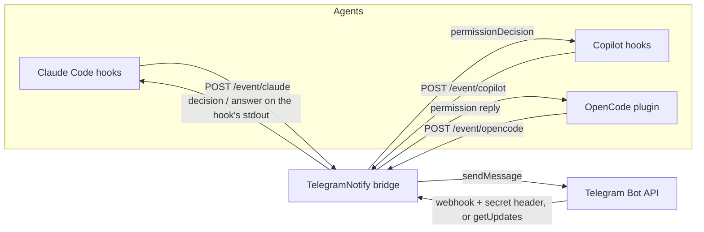

# TelegramNotify

Sends Claude Code, GitHub Copilot and OpenCode events to a Telegram bot, and carries
the answer back to the agent. One long-running Node process owns a loopback-only
API that the agent hooks call, and receives Telegram traffic either through a
webhook protected by a secret token or by long polling.



- **Needs a decision?** The hook blocks, the message waits in Telegram, and the
  answer travels back in the agent's native format.
- **Task completed?** A one-way notification. Claude's closing message is read
  from the transcript tail so the phone shows the result, not just "done".
- **Two delivery modes.** Webhook mode registers a URL with Telegram and checks
  `X-Telegram-Bot-Api-Secret-Token` on every call; polling mode needs no public
  host at all. Either way only the configured chat ids are allowed to answer.

## Requirements

- VS Code 1.90 or newer for the settings UI and commands, or Node.js 18.17+ for
  the CLI (no npm dependencies).
- A Telegram bot token from [@BotFather](https://t.me/BotFather) and the chat id
  that should receive the notifications.
- For webhook mode only: a public HTTPS URL. Telegram does not call plain HTTP,
  so put a tunnel or reverse proxy in front of the bridge, for example
  `cloudflared tunnel --url http://127.0.0.1:8787` or `ngrok http 8787` — or turn
  **Enable Webhook** off and use long polling instead.

## Installation

```powershell
git clone <this repository> TelegramNotify
cd TelegramNotify
```

Then make VS Code load it, either way:

```powershell
# a) package and install a VSIX
npm run package
code --install-extension telegram-notify-1.1.0.vsix

# b) or link the folder directly (Windows)
New-Item -ItemType Junction -Path "$env:USERPROFILE\.vscode\extensions\local.telegram-notify-1.1.0" `
  -Target (Get-Location)
```

Reload the window. The settings appear under **TelegramNotify** in the Settings UI
(also reachable with `@ext:local.telegram-notify` in the Settings search box, or
**TelegramNotify: Open Settings** from the command palette).

## Quick start in VS Code

1. Open Settings, search `telegramNotify`, and fill in:
   - **Enable Notification** — the master switch (on by default);
   - **Bot Token** — from @BotFather;
   - **Chat Id** — the chat that should receive notifications;
   - **Agents: Copilot / Claude / OpenCode** — the three enable switches;
   - **Enable Webhook** — on: serve the webhook on **Webhook Port** and register
     **Public Url**; off: long polling, no nginx or public host needed;
   - **Webhook Secret Token** — leave empty and it is generated on first start.
2. Click the **TG** icon in the status bar to turn notifications on or off. The
   click writes `telegramNotify.notificationsEnabled`, so the state survives a
   restart. `$(bell) TG` means on, `$(bell-slash) TG` means off, and the tooltip
   reports the delivery mode.
3. Run **TelegramNotify: Install Agent Hooks** and pick the agents.
4. With **Enable Webhook** on, expose the port
   (`cloudflared tunnel --url http://127.0.0.1:8787`), put the HTTPS host into
   **Public Url**, then run **TelegramNotify: Register Telegram Webhook** (or
   restart the bridge — a `publicUrl` registers it on start).

Settings are the source of truth: the extension reads them from the VS Code
settings section, and the agent hooks read the same file, so nothing has to be
kept in step. See [Configuration file](#configuration-file). Nothing else needs to
run for the bridge; VS Code hosts it.

| Setting | Config key | Default |
| --- | --- | --- |
| `telegramNotify.notificationsEnabled` | `notificationsEnabled` | `true` |
| `telegramNotify.botToken` | `botToken` | empty (required) |
| `telegramNotify.chatId` | `chatId` | empty (required) |
| `telegramNotify.agents.copilot` | `agents.copilot` | `true` |
| `telegramNotify.agents.claude` | `agents.claude` | `true` |
| `telegramNotify.agents.opencode` | `agents.opencode` | `true` |
| `telegramNotify.notifyOnCompleted` | `notifyOnCompleted` | `true` |
| `telegramNotify.notifyOnStart` | `notifyOnStart` | `false` |
| `telegramNotify.replyTimeoutSeconds` | `replyTimeoutSeconds` | `900` |
| `telegramNotify.maxMessageLength` | `maxMessageLength` | `3800` |
| `telegramNotify.webhookEnabled` | `webhookEnabled` | `true` |
| `telegramNotify.webhookPort` | `webhookPort` | `8787` |
| `telegramNotify.webhookHost` | `webhookHost` | `0.0.0.0` |
| `telegramNotify.webhookPath` | `webhookPath` | `/telegram/webhook` |
| `telegramNotify.webhookSecretToken` | `webhookSecretToken` | generated |
| `telegramNotify.publicUrl` | `publicUrl` | empty |
| `telegramNotify.pollingTimeoutSeconds` | `pollingTimeoutSeconds` | `25` |
| `telegramNotify.logLevel` | — (editor only) | `info` |

Commands: **Toggle Notifications** (status bar click), **Start/Stop/Restart
Bridge**, **Show Status** (also lists pending questions; pick one to cancel),
**Send Test Notification**, **Install Agent Hooks**, **Register Telegram
Webhook**, **Show Log**.

Changing a bridge setting restarts a running bridge automatically. Changing
`notificationsEnabled` stops or starts it; changing `webhookEnabled` switches it
between webhook and polling. `logLevel` is applied without a restart. Prefer the
extension in VS Code; the CLI below is for machines without the editor, CI, or a
service install.

## Delivery modes

Telegram allows one delivery method per bot: while a webhook is registered,
`getUpdates` fails with `409 Conflict`.

| `webhookEnabled` | What happens |
| --- | --- |
| on | The bridge listens on `webhookPort`, `publicUrl` is registered with Telegram, and the secret-token header is checked. Needs a public HTTPS host in front of it. |
| off | The bridge deletes the webhook and collects answers with `getUpdates` long polling every `pollingTimeoutSeconds`. No nginx, no certificate, no public URL — only outbound HTTPS to `api.telegram.org`. |

The bridge itself runs in both modes: the agent hooks call it on loopback, so
notifications and answers always flow through the same local API. Switching the
setting restarts the bridge in the other mode.

Polling is the right choice behind NAT or when the reverse proxy is not set up;
the webhook is the right choice when the PC may sleep or close VS Code, because
Telegram retries a webhook but nobody polls while the process is gone.

Commands: `serve` (add `--polling` to force polling mode without editing the
config), `init`, `doctor`, `send`, `webhook set|info|delete`, `install`, `config`,
`pending`, `status`.

## Quick start from the CLI

The CLI reads the same VS Code settings when they exist, so a machine with both
needs nothing extra. For a machine without the editor, create a standalone file:

```powershell
cd <extension folder>
npm run init                 # writes config.json to %APPDATA%\TelegramNotify
notepad "$env:APPDATA\TelegramNotify\config.json"   # set botToken and chatId
npm start                    # bridge on port 8787
```

In a second terminal, expose the port and register the webhook:

```powershell
cloudflared tunnel --url http://127.0.0.1:8787
# put the https://<random>.trycloudflare.com host in the user config -> publicUrl
node src\cli.mjs webhook set
node src\cli.mjs doctor
```

Then install the hooks in the project you work in:

```powershell
cd <your project>
node <extension folder>\src\cli.mjs install --agent all
```

Open a chat with the bot and send `/status` to confirm two-way traffic.

To keep the bridge running after the terminal closes, register it with Task
Scheduler or NSSM; the command is `node src\cli.mjs serve` with the extension
folder as the working directory.

## Reverse proxy (nginx)

Telegram only calls HTTPS, so a webhook install needs a public host name in front
of the bridge. A commented starting point ships as
`deploy/nginx/telegram-notify.conf.example`:

- `server_name telegram.example.com` — must be the host inside
  `telegramNotify.publicUrl`;
- `upstream telegram_notify { server 192.0.2.10:8787; }` — the LAN address of the
  PC running VS Code;
- one certificate for that host, for example
  `/etc/letsencrypt/live/telegram.example.com/fullchain.pem`;
- only `POST /telegram/webhook` is proxied. `/health`, `/pending` and `/event/*`
  stay loopback-only, so nothing else of the bridge is published.

```bash
sudo cp telegram-notify.conf.example /etc/nginx/sites-available/telegram-notify.conf
sudo ln -sf /etc/nginx/sites-available/telegram-notify.conf /etc/nginx/sites-enabled/
sudo nginx -t && sudo systemctl reload nginx
curl -sS -o /dev/null -w '%{http_code}\n' https://telegram.example.com/telegram/webhook
```

The last `curl` must print `405` (GET is refused; the path exists) rather than
`404` or `502`. Then restart the bridge in VS Code so it registers the URL with
Telegram, and confirm with `node src\cli.mjs webhook info`.

Two things on the Windows side:

- the bridge binds `0.0.0.0`, so allow inbound TCP 8787 from the nginx server only
  (use the address of the host that runs nginx):

  ```powershell
  New-NetFirewallRule -DisplayName "TelegramNotify 8787" -Direction Inbound `
    -Protocol TCP -LocalPort 8787 -RemoteAddress 192.0.2.20 -Action Allow
  ```

- give the PC a DHCP reservation, otherwise the `upstream` address goes stale.

If `telegramNotify.webhookPath` is ever changed, update the two `location =`
blocks to match. Set **Enable Webhook** off if you cannot expose a public host:
answers then arrive by long polling with no nginx at all.

## Configuration file

There isn't one to maintain. **VS Code's own user settings are the config store**,
in the `telegramNotify` section of:

| Platform | File |
| --- | --- |
| Windows | `%APPDATA%\Code\User\settings.json` |
| macOS | `~/Library/Application Support/Code/User/settings.json` |
| Linux | `~/.config/Code/User/settings.json` |

The agent hooks run as separate processes, spawned by Claude Code, Copilot and
OpenCode rather than by VS Code, so they read that same file to learn the bridge
port, the reply timeout and the enabled agents. Nothing is duplicated, so the
editor and the hooks cannot disagree, and no secret is ever written into the
extension folder or a repository.

`config.json` is still supported for machines without VS Code — CI, a service, a
container. Precedence:

1. `--config <file>` or `TELEGRAM_NOTIFY_CONFIG`;
2. VS Code `settings.json` (the normal case);
3. a standalone `config.json` in the user data folder.

Nothing inside the extension folder is ever read or written, so a source checkout
can never supply stale values. `npm run init` writes that standalone file, and
`TELEGRAM_NOTIFY_SETTINGS` points the loader at a different `settings.json` (used
by the tests).

| Key | Meaning | Default |
| --- | --- | --- |
| `notificationsEnabled` | Master switch. Off means nothing is sent and the bridge does not run. | `true` |
| `botToken` | Bot token from @BotFather. | — (required) |
| `chatId` | Chat that receives notifications. One id, a comma-separated list, or an array. Group ids start with `-`. | — (required) |
| `agents.copilot` | Enable Copilot events. | `true` |
| `agents.claude` | Enable Claude Code events. | `true` |
| `agents.opencode` | Enable OpenCode events. | `true` |
| `notifyOnCompleted` | Send the task-completed notification. | `true` |
| `notifyOnStart` | Copilot only: announce that a prompt was submitted. | `false` |
| `replyTimeoutSeconds` | How long a hook waits for an answer before the agent continues. | `900` |
| `maxMessageLength` | Upper bound for one Telegram message. | `3800` |
| `webhookEnabled` | On: webhook delivery. Off: long polling, and no secret token is needed. | `true` |
| `webhookPort` | Port the webhook and the local agent API listen on. Used in both modes. | `8787` |
| `webhookHost` | Interface to bind. `0.0.0.0` lets a reverse proxy reach it. | `0.0.0.0` |
| `webhookPath` | Webhook path. `/telegram/webhook` and `/webhook` also work. | `/telegram/webhook` |
| `webhookSecretToken` | Secret Telegram echoes in every webhook call (`A-Z a-z 0-9 _ -`, 1–256 chars). Generated by `npm run init`. | webhook mode only |
| `publicUrl` | Public HTTPS base (reverse proxy host). `serve` registers the webhook automatically when set. | empty |
| `pollingTimeoutSeconds` | Long-poll wait per request, polling mode only. | `25` |

The keys are grouped the same way the Settings UI shows them: notifications and
agents first, then the webhook block.

Environment variables override the file, which is useful for a service or a
container:

| Variable | Overrides |
| --- | --- |
| `TELEGRAM_NOTIFY_BOT_TOKEN` | `botToken` |
| `TELEGRAM_NOTIFY_CHAT_ID` | `chatId` |
| `TELEGRAM_NOTIFY_NOTIFICATIONS_ENABLED` | `notificationsEnabled` |
| `TELEGRAM_NOTIFY_WEBHOOK_ENABLED` | `webhookEnabled` |
| `TELEGRAM_NOTIFY_WEBHOOK_PORT` | `webhookPort` |
| `TELEGRAM_NOTIFY_WEBHOOK_SECRET` | `webhookSecretToken` |
| `TELEGRAM_NOTIFY_AGENT_COPILOT` / `..._CLAUDE` / `..._OPENCODE` | per-agent switch |
| `TELEGRAM_NOTIFY_PUBLIC_URL` | `publicUrl` |
| `TELEGRAM_NOTIFY_CONFIG` | config file path (skips the settings file) |
| `TELEGRAM_NOTIFY_SETTINGS` | path to a VS Code `settings.json` to read instead of the default |
| `TELEGRAM_NOTIFY_API_BASE` | Bot API base URL, for a local Bot API server or a test double |
| `TELEGRAM_NOTIFY_HOME` | folder holding a standalone `config.json` for CLI-only installs |
| `TELEGRAM_NOTIFY_URL` | bridge URL used by hooks (default `http://127.0.0.1:<webhookPort>`) |
| `TELEGRAM_NOTIFY_HOOK_TIMEOUT` | timeout a hook allows itself, in seconds |
| `TELEGRAM_NOTIFY_LOG_LEVEL` | `silent`, `error`, `warn`, `info`, `debug` |

## Answering from Telegram

Every request that expects an answer carries inline buttons (`1. Allow once`,
`2. Deny`, or the question's own options). Any of these work:

- tap a button;
- reply to the notification message with free text;
- `/answer <id> <text>` (the id is shown by `/list`);
- `/1`, `/2`, … for the newest request;
- `/cancel <id>` to stop waiting and let the agent continue.

`/list` shows pending requests with the seconds left, `/status` shows the bridge
state and the enabled agents. After an answer the original message is edited to
show what was sent and when, so the chat doubles as a log. Unanswered requests
expire after `replyTimeoutSeconds` and the agent falls back to its normal prompt.

Notifications are HTML-escaped, truncated to `maxMessageLength`, and sent with
the agent name and working directory.

## Agent setup

`install` writes the hook files for the project in the current directory. Pass
`--project <dir>` for another root, `--global` where a user-level config exists
(Copilot, Claude Code and OpenCode), `--agent copilot|claude|opencode|all`, and
`--approvals` for Copilot.

### Claude Code

`install --agent claude` merges into `.claude/settings.json` (or
`~/.claude/settings.json` with `--global`):

| Hook | Behaviour |
| --- | --- |
| `PermissionRequest` | Blocking. Buttons `Allow once` / `Deny`; the answer is printed as a native `hookSpecificOutput.decision`. Timeout means no output, so the terminal prompt stays. |
| `PreToolUse` (`AskUserQuestion`) | Blocking. The question's options become buttons; the answer returns as a `permissionDecision: "deny"` reason, which is how a non-terminal answer reaches the model. Free text is accepted too; several questions can be answered as `a | b`. |
| `Notification` | Notification only, because Claude Code also raises `PermissionRequest` for approvals and the terminal prompt must not be delayed. |
| `Stop`, `SubagentStop`, `TaskCompleted` | Completion notification. The last assistant message is read from the tail of the transcript. |

Restart Claude Code, or start a new session, so the hooks reload. Hook timeouts
are written as `replyTimeoutSeconds + 60`; a shorter hook timeout would kill the
process before the answer arrives. The command pins the Node executable the
installer resolved, so re-run `install` after moving or upgrading Node.

### GitHub Copilot

`install --agent copilot` writes `.github/hooks/telegram-notify.json` in the
project, or `~/.copilot/hooks/telegram-notify.json` with `--global`, with
`sessionEnd`, `agentStop` and `errorOccurred` notifications. With `--approvals`
it also adds a blocking `preToolUse` hook that answers with `permissionDecision`
(`allow`/`deny`).

Copilot hooks are read when a session starts, so install them per project (or
once with `--global` for every workspace) and start a new chat afterwards. VS
Code runs the `powershell` command from the hook config, so the installer writes
`& "<node>" "<hook>"`: a quoted executable without `&` is a parse error in
PowerShell and the hook would never run. When the installer runs inside the
VS Code extension host, `process.execPath` is `Code.exe`, so it resolves `node`
from `PATH` instead (falling back to `ELECTRON_RUN_AS_NODE`). The event name is
passed as an argument because the VS Code agent host sends no event field on
stdin; the hook still accepts Claude-style `hook_event_name` payloads.

Approve-every-tool is deliberately opt-in: it turns each tool call into a
Telegram round trip. Without `--approvals`, Copilot gets completion and error
notifications only.

Hosts that embed Copilot without a hook config can still reach the bridge: post
the same payload to `POST /event/copilot` from the host's event handler.

### OpenCode

`install --agent opencode` writes `.opencode/telegram-notify.mjs` (a stub that
re-exports the plugin from this folder) and adds it to `opencode.json`:

```json
{
  "plugin": ["./.opencode/telegram-notify.mjs"]
}
```

The plugin listens for `permission.asked` (buttons `Allow once` / `Always allow` /
`Deny`, answered through the OpenCode client), `session.idle` and
`session.execution.succeeded` (completion, deduplicated), `session.execution.failed`
and `session.execution.interrupted`. Restart OpenCode after installing. Because the
plugin runs inside OpenCode, the bridge must already be running.

## HTTP API

All local endpoints are loopback-only and the server refuses requests with a
non-local remote address.

| Endpoint | Purpose |
| --- | --- |
| `POST /event/{copilot\|claude\|opencode}` | Submit an event. Disabled agents answer `202` with `skipped: true`. |
| `POST /notify` | Same body without an agent (generic notification). |
| `GET /health` | Readiness, port, delivery mode, polling stats, agents, pending count. |
| `GET /pending` | Requests waiting for an answer. |
| `POST /pending/{id}/cancel` | Cancel one request. |
| `POST {webhookPath}` | Telegram updates. Requires the secret-token header; answers `409` when the webhook is disabled. |

Event body:

```json
{
  "type": "permission",
  "title": "Deploy?",
  "message": "Push the release branch to production.",
  "detail": "branch=release/2.0\ncommit=abc123",
  "cwd": "D:\\Projects\\app",
  "options": ["Allow once", "Deny"],
  "waitForReply": true,
  "timeoutSeconds": 300
}
```

`type` is `question`, `permission`, `completed`, `info` or `error`. A blocking
request answers with `{ ok, requestId, messageId, source, answer, reply,
optionIndex, timedOut, text }`; `text` is the value to act on.

## Security

- The webhook path requires `X-Telegram-Bot-Api-Secret-Token`; comparison is
  constant-time and a missing or wrong value gets `401` before the body is read.
  This is the only authentication Telegram offers, so treat the secret like a
  password and rotate it with `npm run init -- --force` plus `webhook set`.
- Only chat ids listed in `chatId` can answer. Messages and button presses from
  any other chat are logged and ignored, so a leaked bot link cannot approve a
  tool call.
- The agent API binds to loopback for anything that can answer a request.
  `webhookHost: 0.0.0.0` exists only so a tunnel can reach the webhook.
- `config.json` is only for CLI-only installs. In the normal setup the bot token
  lives in VS Code's `settings.json`, outside the extension and any repository;
  keep it readable by the current user only.
- Hooks never fail an agent: a missing bridge, bad config or Telegram outage
  exits `0` with no decision, leaving the normal terminal prompt in place.

## Troubleshooting

| Symptom | Check |
| --- | --- |
| `401 invalid secret token` in the log | `webhookSecretToken` differs from what is registered. Run `webhook set` after changing it. |
| Telegram never calls the bridge | `node src\cli.mjs webhook info` — the URL must be HTTPS and `last_error_message` explains refusals. Cloudflared quick tunnels get a new host on every start. |
| `doctor` says the bridge is not running | `npm start` is not up, or `webhookPort`/`webhookHost` differ between the two processes. |
| Buttons do nothing | The bot must be able to write in the chat; for groups, add the bot as a member and use the group's `-100...` id. |
| Claude Code shows no notifications | Restart the session; hooks are read at start. Check `.claude/settings.json` with `/hooks`. |
| Copilot shows no notifications when a task finishes | Hooks are read at session start: install them with **Install Agent Hooks** (project or user settings) or `install --agent copilot`, then start a new chat. The bridge alone cannot see agent events. |
| The settings are not in the Settings UI | The folder is not linked into VS Code. Either run `code --install-extension <path>.vsix`, or create a junction named `local.telegram-notify-<version>` in `%USERPROFILE%\.vscode\extensions` that points at the extension folder, then reopen VS Code. |
| `TelegramNotify: Start Bridge` says the port is in use | Another bridge (or `npm start`) already holds `webhookPort`. Stop it, or change the port. |
| The bridge did not pick up a config change | The file is read at startup. Restart `npm start`. |
| Telegram shows `last_error_message: … 404 Not Found` | The nginx site is not loaded, so the click/reply never reaches the PC. `node src\cli.mjs doctor` reports `public reachable: 404`; deploy the site and reload nginx. Telegram keeps the old error after recovery, which `doctor` labels "resolved" once the URL answers again. |
| The question appears in Telegram but the agent keeps waiting | Same cause: Telegram cannot POST the answer. `doctor` prints `public reachable: 404` or `502`; the local `/pending` call from a hook still works, so a message is sent but no answer returns. |
| Permission answer arrives but the tool still runs in the terminal | The hook timed out first. Increase `replyTimeoutSeconds` before reinstalling hooks. |
| OpenCode ignores the plugin | `opencode.json` must be valid JSON and the plugin path correct; restart OpenCode. |
| The webhook is off but no answer arrives | Polling only works while the bridge runs. Check **Show Status** for `polling` and the update count, and `node src\cli.mjs status` from a terminal. |
| Switching Enable Webhook does nothing | The bridge restarts in the new mode; watch **Show Log** for `delivery is polling` / `webhook registered`. A `409` in the log means Telegram still has an old webhook — the extension deletes it on start. |
| Notifications stop after clicking the TG icon | That click is the switch: `$(bell-slash) TG` is off. Click again, or set **Enable Notification** back on. |
| Windows prompt about the port | Allow Node.js on the private network, or bind `webhookHost` to `127.0.0.1` and use a tunnel. |

## Layout

```
deploy/nginx/telegram-notify.conf.example   reverse proxy starting point
extension.js               VS Code extension host (settings, commands, status bar)
config.example.json        template for a CLI-only config.json
LICENSE                    MIT
src/cli.mjs                command line entry point
src/settings.mjs           VS Code settings -> config mapping
src/config.mjs             config load, env overrides, validation
src/notifier.mjs           event -> Telegram message, answer routing, commands
src/pending.mjs            waiting requests, timeouts, reply correlation
src/polling.mjs            long-polling receiver used when the webhook is off
src/telegram.mjs           Bot API client (node:http(s), pooled sockets)
src/server.mjs             webhook + local API
src/message.mjs            HTML formatting
src/reachability.mjs       public webhook probe used by doctor and the extension
src/install.mjs            Claude Code, Copilot and OpenCode hook installers
src/hooks/claude-hook.mjs  native decision output for Claude Code
src/hooks/copilot-hook.mjs native decision output for Copilot
src/hooks/opencode-plugin.mjs  OpenCode plugin
test/                      node:test suite (89 tests)
```

## Development

```powershell
npm test
```

The suite runs the real HTTP server against an in-memory Telegram stand-in,
spawns each hook process and verifies its native output, drives the polling
receiver through offsets, 409 conflicts and handler failures, checks that the
installers merge existing settings without duplicating entries, and asserts the
manifest contributes every setting the settings module maps in the order the UI
shows them.

## Contributing

- VS Code is the config store, so a checkout never holds a token; a standalone
  `config.json` and `*.local.json` are git-ignored as a second line of defence.
- Never paste a real bot token, chat id or webhook secret into an issue, a test or
  a commit; the whole point of the secret token is that it stays private.
- Run `npm test` before opening a pull request.

## License

MIT — see `LICENSE`.
