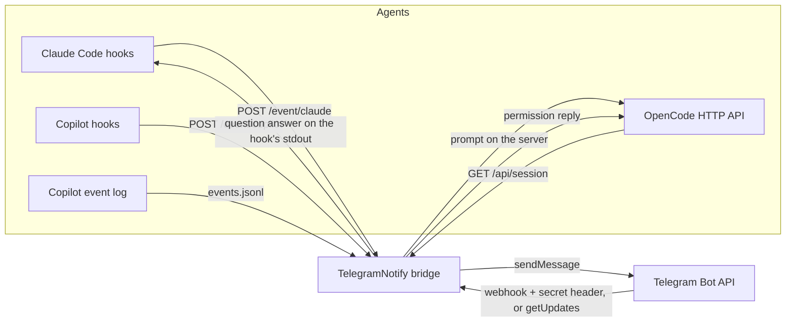

# TelegramNotify

Sends Claude Code, GitHub Copilot and OpenCode events to a Telegram bot, and carries
the answer back to the agent. One long-running Node process owns a loopback-only
API that the agent hooks call, and receives Telegram traffic either through a
webhook protected by a secret token or by long polling.



- **A question needs an answer?** The hook blocks, the message waits in Telegram, and
  the answer travels back in the agent's native format.
- **A permission is waiting in the panel?** Telegram is told, but nothing is decided
  there: the agent's own prompt owns the decision. Copilot reports it from its event
  log, Claude Code from its `Notification` hook — so a call that is auto-approved is
  never announced. `panelWaitSeconds` sets how long the prompt may wait first.
- **Task completed?** A one-way notification carrying the agent's answer, read
  from its transcript (Claude Code's and Copilot's formats both), so the phone
  shows the result, not just "done". The reader walks back through the transcript
  until it finds text, because a final turn's tool output can push the message
  hundreds of KB from the end.
- **The answer only.** A turn is a loop of narration and tool calls, so the text
  before the answer ("let me check the query") is progress reporting. Only the
  closing block of messages that do not come with a tool call is sent; the block
  is kept whole, so a long answer is not cut down to its final "Done." line. When
  the agent host ends the turn with its `task_complete` tool, that tool's summary
  is the answer. Hosts also log their own system prompt, hook payloads and session
  bookkeeping in the transcript, and those entries are never part of the answer;
  a turn that was interrupted before it answered sends no text rather than its
  last progress line.
- **Reported once.** Every agent announces the same ending more than once —
  Copilot fires `agentStop` then `sessionEnd`, OpenCode `session.idle` then
  `session.execution.succeeded`, Claude Code `Stop` plus `SubagentStop`/
  `TaskCompleted`. Each completion is claimed atomically per turn (keyed on the
  transcript message id), so one finish produces one message.
- **Two delivery modes.** Webhook mode registers a URL with Telegram and checks
  `X-Telegram-Bot-Api-Secret-Token` on every call; polling mode needs no public
  host at all. Either way only the configured chat ids are allowed to answer.

## Requirements

- VS Code 1.90 or newer for the settings UI and commands, or Node.js 18.17+ for
  the CLI (no npm dependencies).
- A Telegram bot token from [@BotFather](https://t.me/BotFather) and the chat id
  that should receive the notifications.
- For webhook mode only: a public HTTPS URL. Telegram does not call plain HTTP,
  so put a tunnel or reverse proxy in front of the bridge, for example
  `cloudflared tunnel --url http://127.0.0.1:8787` or `ngrok http 8787` — or turn
  **Enable Webhook** off and use long polling instead.

## Installation

```powershell
git clone <this repository> TelegramNotify
cd TelegramNotify
```

Then make VS Code load it, either way:

```powershell
# a) package and install a VSIX
npm run package
code --install-extension telegram-notify-1.1.0.vsix

# b) or link the folder directly (Windows)
New-Item -ItemType Junction -Path "$env:USERPROFILE\.vscode\extensions\local.telegram-notify-1.1.0" `
  -Target (Get-Location)
```

Reload the window. The settings appear under **TelegramNotify** in the Settings UI
(also reachable with `@ext:local.telegram-notify` in the Settings search box, or
**TelegramNotify: Open Settings** from the command palette).

## Quick start in VS Code

1. Open Settings, search `telegramNotify`, and fill in:
   - **Enable Notification** — the master switch (on by default);
   - **Bot Token** — from @BotFather;
   - **Chat Id** — the chat that should receive notifications;
   - **Agents: Copilot / Claude / OpenCode** — the three enable switches;
   - **Enable Webhook** — on: serve the webhook on **Webhook Port** and register
     **Public Url**; off: long polling, no nginx or public host needed;
   - **Webhook Secret Token** — leave empty and it is generated on first start.
2. Click the **TG** icon in the status bar to turn notifications on or off. The
   click writes `telegramNotify.notificationsEnabled`, so the state survives a
   restart. `$(bell) TG` means on, `$(bell-slash) TG` means off, and the tooltip
   reports the delivery mode.
3. Run **TelegramNotify: Install Agent Hooks** and pick the agents.
4. With **Enable Webhook** on, expose the port
   (`cloudflared tunnel --url http://127.0.0.1:8787`), put the HTTPS host into
   **Public Url**, then run **TelegramNotify: Register Telegram Webhook** (or
   restart the bridge — a `publicUrl` registers it on start).

Settings are the source of truth: the extension reads them from the VS Code
settings section, and the agent hooks read the same file, so nothing has to be
kept in step. See [Configuration file](#configuration-file). Nothing else needs to
run for the bridge; VS Code hosts it.

| Setting | Config key | Default |
| --- | --- | --- |
| `telegramNotify.notificationsEnabled` | `notificationsEnabled` | `true` |
| `telegramNotify.botToken` | `botToken` | empty (required) |
| `telegramNotify.chatId` | `chatId` | empty (required) |
| `telegramNotify.agents.copilot` | `agents.copilot` | `true` |
| `telegramNotify.agents.claude` | `agents.claude` | `true` |
| `telegramNotify.agents.opencode` | `agents.opencode` | `true` |
| `telegramNotify.notifyOnCompleted` | `notifyOnCompleted` | `true` |
| `telegramNotify.notifyOnStart` | `notifyOnStart` | `false` |
| `telegramNotify.replyTimeoutSeconds` | `replyTimeoutSeconds` | `900` |
| `telegramNotify.maxMessageLength` | `maxMessageLength` | `3800` |
| `telegramNotify.webhookEnabled` | `webhookEnabled` | `true` |
| `telegramNotify.webhookPort` | `webhookPort` | `8787` |
| `telegramNotify.webhookHost` | `webhookHost` | `0.0.0.0` |
| `telegramNotify.webhookPath` | `webhookPath` | `/telegram/webhook` |
| `telegramNotify.webhookSecretToken` | `webhookSecretToken` | generated |
| `telegramNotify.publicUrl` | `publicUrl` | empty |
| `telegramNotify.pollingTimeoutSeconds` | `pollingTimeoutSeconds` | `25` |
| `telegramNotify.remotePromptEnabled` | `remotePromptEnabled` | `false` |
| `telegramNotify.claudeOpenSession` | `claudeOpenSession` | `true` |
| `telegramNotify.claudeAskWindowSeconds` | `claudeAskWindowSeconds` | `20` |
| `telegramNotify.panelWaitSeconds` | `panelWaitSeconds` | `20` |
| `telegramNotify.logLevel` | — (editor only) | `info` |

Commands: **Toggle Notifications** (status bar click), **Start/Stop/Restart
Bridge**, **Show Status** (also lists pending questions; pick one to cancel),
**Send Test Notification**, **Install Agent Hooks**, **Register Telegram
Webhook**, **Show Log**.

Changing a bridge setting restarts a running bridge automatically. Changing
`notificationsEnabled` stops or starts it; changing `webhookEnabled` switches it
between webhook and polling. `logLevel` is applied without a restart. Prefer the
extension in VS Code; the CLI below is for machines without the editor, CI, or a
service install. Copilot and Claude remote prompts need the extension host: they
are submitted to VS Code Chat, which is where their session lives. Without an
editor a Claude prompt still runs through the agent's own runtime, but it cannot
join the Chat session on screen. OpenCode prompts work from a terminal too, and
only the "show me that session" step needs the editor.

## Delivery modes

Telegram allows one delivery method per bot: while a webhook is registered,
`getUpdates` fails with `409 Conflict`.

| `webhookEnabled` | What happens |
| --- | --- |
| on | The bridge listens on `webhookPort`, `publicUrl` is registered with Telegram, and the secret-token header is checked. Needs a public HTTPS host in front of it. |
| off | The bridge deletes the webhook and collects answers with `getUpdates` long polling every `pollingTimeoutSeconds`. No nginx, no certificate, no public URL — only outbound HTTPS to `api.telegram.org`. |

The bridge itself runs in both modes: the agent hooks call it on loopback, so
notifications and answers always flow through the same local API. Switching the
setting restarts the bridge in the other mode.

Polling is the right choice behind NAT or when the reverse proxy is not set up;
the webhook is the right choice when the PC may sleep or close VS Code, because
Telegram retries a webhook but nobody polls while the process is gone.

Both modes acknowledge an update before the work it triggers finishes. A prompt
can run for minutes while Telegram waits only a few seconds for the webhook call,
so the bridge answers `200` first and then runs the update out of band. A
redelivered update — same `update_id`, or the same message — is dropped instead of
starting the prompt a second time.

Commands: `serve` (add `--polling` to force polling mode without editing the
config), `init`, `doctor`, `send`, `webhook set|info|delete`, `install`, `config`,
`pending`, `status`.

## Quick start from the CLI

The CLI reads the same VS Code settings when they exist, so a machine with both
needs nothing extra. For a machine without the editor, create a standalone file:

```powershell
cd <extension folder>
npm run init                 # writes config.json to %APPDATA%\TelegramNotify
notepad "$env:APPDATA\TelegramNotify\config.json"   # set botToken and chatId
npm start                    # bridge on port 8787
```

In a second terminal, expose the port and register the webhook:

```powershell
cloudflared tunnel --url http://127.0.0.1:8787
# put the https://<random>.trycloudflare.com host in the user config -> publicUrl
node src\cli.mjs webhook set
node src\cli.mjs doctor
```

Then install the hooks in the project you work in:

```powershell
cd <your project>
node <extension folder>\src\cli.mjs install --agent all
```

Open a chat with the bot and send `/status` to confirm two-way traffic.

To keep the bridge running after the terminal closes, register it with Task
Scheduler or NSSM; the command is `node src\cli.mjs serve` with the extension
folder as the working directory.

## Reverse proxy (nginx)

Telegram only calls HTTPS, so a webhook install needs a public host name in front
of the bridge. A commented starting point ships as
`deploy/nginx/telegram-notify.conf.example`:

- `server_name telegram.example.com` — must be the host inside
  `telegramNotify.publicUrl`;
- `upstream telegram_notify { server 192.0.2.10:8787; }` — the LAN address of the
  PC running VS Code;
- one certificate for that host, for example
  `/etc/letsencrypt/live/telegram.example.com/fullchain.pem`;
- only `POST /telegram/webhook` is proxied. `/health`, `/pending` and `/event/*`
  stay loopback-only, so nothing else of the bridge is published.

```bash
sudo cp telegram-notify.conf.example /etc/nginx/sites-available/telegram-notify.conf
sudo ln -sf /etc/nginx/sites-available/telegram-notify.conf /etc/nginx/sites-enabled/
sudo nginx -t && sudo systemctl reload nginx
curl -sS -o /dev/null -w '%{http_code}\n' https://telegram.example.com/telegram/webhook
```

The last `curl` must print `405` (GET is refused; the path exists) rather than
`404` or `502`. Then restart the bridge in VS Code so it registers the URL with
Telegram, and confirm with `node src\cli.mjs webhook info`.

Two things on the Windows side:

- the bridge binds `0.0.0.0`, so allow inbound TCP 8787 from the nginx server only
  (use the address of the host that runs nginx):

  ```powershell
  New-NetFirewallRule -DisplayName "TelegramNotify 8787" -Direction Inbound `
    -Protocol TCP -LocalPort 8787 -RemoteAddress 192.0.2.20 -Action Allow
  ```

- give the PC a DHCP reservation, otherwise the `upstream` address goes stale.

If `telegramNotify.webhookPath` is ever changed, update the two `location =`
blocks to match. Set **Enable Webhook** off if you cannot expose a public host:
answers then arrive by long polling with no nginx at all.

## Configuration file

There isn't one to maintain. **VS Code's own user settings are the config store**,
in the `telegramNotify` section of:

| Platform | File |
| --- | --- |
| Windows | `%APPDATA%\Code\User\settings.json` |
| macOS | `~/Library/Application Support/Code/User/settings.json` |
| Linux | `~/.config/Code/User/settings.json` |

The agent hooks run as separate processes, spawned by Claude Code, Copilot and
OpenCode rather than by VS Code, so they read that same file to learn the bridge
port, the reply timeout and the enabled agents. Nothing is duplicated, so the
editor and the hooks cannot disagree, and no secret is ever written into the
extension folder or a repository.

`config.json` is still supported for machines without VS Code — CI, a service, a
container. Precedence:

1. `--config <file>` or `TELEGRAM_NOTIFY_CONFIG`;
2. VS Code `settings.json` (the normal case);
3. a standalone `config.json` in the user data folder.

Nothing inside the extension folder is ever read or written, so a source checkout
can never supply stale values. `npm run init` writes that standalone file, and
`TELEGRAM_NOTIFY_SETTINGS` points the loader at a different `settings.json` (used
by the tests).

| Key | Meaning | Default |
| --- | --- | --- |
| `notificationsEnabled` | Master switch. Off means nothing is sent and the bridge does not run. | `true` |
| `botToken` | Bot token from @BotFather. | — (required) |
| `chatId` | Chat that receives notifications. One id, a comma-separated list, or an array. Group ids start with `-`. | — (required) |
| `agents.copilot` | Enable Copilot events. | `true` |
| `agents.claude` | Enable Claude Code events. | `true` |
| `agents.opencode` | Enable OpenCode events. | `true` |
| `notifyOnCompleted` | Send the task-completed notification. | `true` |
| `notifyOnStart` | Copilot only: announce that a prompt was submitted. | `false` |
| `replyTimeoutSeconds` | How long a hook waits for an answer before the agent continues. | `900` |
| `maxMessageLength` | Size of one Telegram message; longer output is split across several. | `3800` |
| `webhookEnabled` | On: webhook delivery. Off: long polling, and no secret token is needed. | `true` |
| `webhookPort` | Port the webhook and the local agent API listen on. Used in both modes. | `8787` |
| `webhookHost` | Interface to bind. `0.0.0.0` lets a reverse proxy reach it. | `0.0.0.0` |
| `webhookPath` | Webhook path. `/telegram/webhook` and `/webhook` also work. | `/telegram/webhook` |
| `webhookSecretToken` | Secret Telegram echoes in every webhook call (`A-Z a-z 0-9 _ -`, 1–256 chars). Generated by `npm run init`. | webhook mode only |
| `publicUrl` | Public HTTPS base (reverse proxy host). `serve` registers the webhook automatically when set. | empty |
| `pollingTimeoutSeconds` | Long-poll wait per request, polling mode only. | `25` |
| `remotePromptEnabled` | Accept a plain Telegram message as a prompt in VS Code Chat, for the agent used last. | `false` |
| `claudeOpenSession` | Open the Claude Code session a Telegram prompt joins when it runs through Claude Code's own runtime (the fallback path), so the turn is part of the conversation on screen. | `true` |
| `claudeAskWindowSeconds` | Seconds Claude Code's `AskUserQuestion` waits for an answer in Telegram before its own prompt takes over. `0` means only the panel or terminal asks. | `20` |
| `panelWaitSeconds` | Seconds a Copilot `permission.requested` or `ask_user` prompt may stay unanswered in the panel before Telegram is told about it. Passive: nothing is decided from the chat. `0` turns the report off. | `20` |

The keys are grouped the same way the Settings UI shows them: notifications and
agents first, then the webhook block.

Environment variables override the file, which is useful for a service or a
container:

| Variable | Overrides |
| --- | --- |
| `TELEGRAM_NOTIFY_BOT_TOKEN` | `botToken` |
| `TELEGRAM_NOTIFY_CHAT_ID` | `chatId` |
| `TELEGRAM_NOTIFY_NOTIFICATIONS_ENABLED` | `notificationsEnabled` |
| `TELEGRAM_NOTIFY_WEBHOOK_ENABLED` | `webhookEnabled` |
| `TELEGRAM_NOTIFY_WEBHOOK_PORT` | `webhookPort` |
| `TELEGRAM_NOTIFY_WEBHOOK_SECRET` | `webhookSecretToken` |
| `TELEGRAM_NOTIFY_AGENT_COPILOT` / `..._CLAUDE` / `..._OPENCODE` | per-agent switch |
| `TELEGRAM_NOTIFY_PUBLIC_URL` | `publicUrl` |
| `TELEGRAM_NOTIFY_REMOTE_PROMPT` | `remotePromptEnabled` |
| `TELEGRAM_NOTIFY_CLAUDE_OPEN_SESSION` | `claudeOpenSession` |
| `TELEGRAM_NOTIFY_CLAUDE_ASK_WINDOW` | `claudeAskWindowSeconds` |
| `TELEGRAM_NOTIFY_PANEL_WAIT` | `panelWaitSeconds` |
| `TELEGRAM_NOTIFY_ASK_DIR` | folder for the ask markers that stop one request being asked twice (default `%TEMP%\telegram-notify`) |
| `TELEGRAM_NOTIFY_COPILOT_HOME` | Copilot's state folder, read to learn whether a session is in autopilot or allow-all (default `~/.copilot`) |
| `TELEGRAM_NOTIFY_NOTIFY_ON_START` | `notifyOnStart` |
| `TELEGRAM_NOTIFY_CLAUDE_BIN` | `claude` binary used when a Telegram prompt for Claude has to run through Claude Code's own runtime |
| `TELEGRAM_NOTIFY_CLAUDE_SESSION` | fallback-run session: an id to pin one, `new` to always start a new session (default: the session the editor has open in the folder) |
| `TELEGRAM_NOTIFY_OPENCODE_BIN` | `opencode` binary used for Telegram prompts sent to OpenCode |
| `TELEGRAM_NOTIFY_OPENCODE_MODEL` | model for those runs (default `opencode-go/deepseek-v4.1-flash`) |
| `TELEGRAM_NOTIFY_OPENCODE_SESSION` | session a Telegram prompt continues: an id to pin one, `new` to always start a new session (default: the newest session in the open folder) |
| `TELEGRAM_NOTIFY_OPENCODE_URL` / `..._PASSWORD` | OpenCode server to watch instead of the one in `service.json` |
| `TELEGRAM_NOTIFY_CONFIG` | config file path (skips the settings file) |
| `TELEGRAM_NOTIFY_SETTINGS` | path to a VS Code `settings.json` to read instead of the default |
| `TELEGRAM_NOTIFY_API_BASE` | Bot API base URL, for a local Bot API server or a test double |
| `TELEGRAM_NOTIFY_HOME` | folder holding a standalone `config.json` for CLI-only installs |
| `TELEGRAM_NOTIFY_URL` | bridge URL used by hooks (default `http://127.0.0.1:<webhookPort>`) |
| `TELEGRAM_NOTIFY_HOOK_TIMEOUT` | timeout a hook allows itself, in seconds |
| `TELEGRAM_NOTIFY_LOG_LEVEL` | `silent`, `error`, `warn`, `info`, `debug` |

## Answering from Telegram

Every question that expects an answer carries inline buttons (the question's own
options, or `1. Allow once` / `2. Deny` where a hook still asks). Any of these
work:

- tap a button;
- reply to the notification message with free text;
- `/answer <id> <text>` (the id is shown by `/list`);
- `/1`, `/2`, … for the newest request;
- `/cancel <id>` to stop waiting and let the agent continue.

`/list` shows pending requests with the seconds left, `/status` shows the bridge
state and the enabled agents. After an answer the original message is edited to
show what was sent and when, so the chat doubles as a log. Unanswered questions
expire after `replyTimeoutSeconds` and the agent falls back to its normal prompt.
With [remote prompts](#prompts-from-telegram) on, anything that is not a command
or an answer is sent to the agent instead.

**Permission prompts are reports, not questions.** When Copilot's panel or Claude
Code asks for approval, Telegram receives a message with no buttons that says the
prompt is waiting; answer it in the panel or terminal. Reporting it only after the
agent's own prompt appears is what keeps auto-approved calls out of the chat.

## Message formatting

Agent output is Markdown, not plain text, so it is rendered for Telegram instead
of being sent raw:

| Input | Telegram |
| --- | --- |
| `## Heading` | bold line |
| `**bold**`, `*italic*`, `~~strike~~` | bold, italic, strike |
| `` `code` `` | monospace word |
| ```` ```fence``` ```` | monospace block |
| `[text](https://…)` | real link |
| `- item` / `  - item` | `•` / `◦` bullets |
| `> quote` | `▎` quote line |
| `---` | a divider |
| narrow table | aligned monospace block, separator row dropped |
| wide table | one bullet per row with `column: value` pairs |

Everything else is HTML-escaped, so agent output can never break the message or
inject markup. If Telegram still rejects the markup — an older client, an
unsupported tag — the message is resent as plain text rather than lost.

Long output is **split across several messages, never truncated**: each part stays
within `maxMessageLength`, splits prefer a line break, tags are closed and
reopened across the boundary, and an entity like `&amp;` is never cut in half. The
inline keyboard rides on the first message; when a question is answered, the
outcome is appended to the message where it fits and the buttons are cleared. A
runaway answer stops at ten messages and says so.

Notifications are also tagged with the agent name and working directory.

## Prompts from Telegram

With **Enable remote prompt** (`remotePromptEnabled`) on, a message that is not a
command and not an answer becomes a prompt for the agent in use, and the chat is
told immediately where it went:

```
you →  fix the failing test in Scheduler.cs
bot →  ▶ copilot received your prompt in VS Code Chat (the session is in your Chat list).
       fix the failing test in Scheduler.cs
       The answer appears there. Agent hooks report back here when the turn ends.
```

The prompt goes to the agent that **reported an event last** — Copilot when no
agent has reported yet — so there is nothing to configure: switch to Claude or
OpenCode in the editor and the next Telegram prompt follows. The choice is stored
in the extension's global state, so it survives a window reload.

How the prompt reaches each agent, and where the answer comes from:

| Agent | Delivery | Answer |
| --- | --- | --- |
| Copilot | `workbench.action.chat.open` with `{ mode: 'agent', query, isPartialQuery: false }` — the same call VS Code's own actions make, so the session is listed and manageable | read from VS Code's Chat operation log under `%APPDATA%\Code\User\workspaceStorage\<folder>\chatSessions` |
| Claude | `workbench.action.chat.open` with `{ query, isPartialQuery: false }` — no `mode`, so the prompt goes into the session on screen instead of being switched to Copilot; that is the Claude session while Claude is the agent in use | the `Stop` hook posts the turn's complete answer from the transcript; nothing is streamed while it runs |
| OpenCode | the OpenCode server: `POST /api/session/<id>/prompt`, so the turn runs where the sidebar and desktop app can see it (falls back to `opencode run --standalone` when no server answers) | the turn's text, read back from the session once its `idle` message arrives (the CLI's JSON stream on the fallback path) |

**Why a Claude prompt goes through Chat.** The "Claude" entry in the VS Code Chat
agent picker is a native *agent host* (`agent-host-claude`) that VS Code drives
itself. It exposes no agent-specific prompt command to extensions, but it does not
need one: `workbench.action.chat.open` submits into the chat session in front of
the user, so a prompt sent while the Claude session is the one on screen continues
that conversation — the same call, and the same behaviour, as a Copilot prompt.
The call deliberately passes no `mode`: switching the widget to "agent" would move
the prompt out of the Claude session and into Copilot.

**When Chat will not take it, Claude Code's runtime answers.** A bridge started
from a terminal has no editor to submit to, and a window can refuse the command
when no Chat session is open. The prompt then runs through Claude Code's own
runtime — the `claude` binary the Claude Code extension ships — which accepts a
prompt, fires the same hooks, and writes the same
`~/.claude/projects/<project>/<session>.jsonl` transcript. The binary is found on
`PATH` or in the Claude Code extension folder; set `TELEGRAM_NOTIFY_CLAUDE_BIN` to
use a different one.

**A Claude fallback run joins the session the editor has open.** Each running
Claude process records its session in `~/.claude/sessions/<pid>.json`; the newest
one whose `cwd` is the open folder, whose process is alive, and which the *editor*
owns (a `claude -p` run registers itself too, with `entrypoint: "sdk-cli"`, and
resuming that would keep the conversation invisible) is the session the prompt is
sent to with `--resume`. So the prompt and its answer are appended to that same
conversation: they are in its transcript, in its history, and in its context for
the next turn. With no such session — Claude Code closed, or a folder it never
opened — the run starts a new one, and the answer says so instead of leaving the
turn unaccounted for.

**The turn behaves like a typed turn.** Claude Code records the permission mode on
every user entry of the transcript (`"permissionMode":"bypassPermissions"`,
`"acceptEdits"`, `"plan"`, …), so the fallback run reads the session's current mode
and passes it as `--permission-mode`. A session that auto-accepts edits therefore
does the same for a Telegram prompt, instead of stopping at every tool to ask in
the chat — which is what made a Telegram prompt feel different from one typed in
the panel. `default` is not a flag (it is what happens without one), so a session
in default mode still asks where it would have asked.

**Two kinds of request.** A question still waits for Telegram; a permission is
only reported once the agent's own prompt is waiting.

| Request | What Telegram does | Answered where |
| --- | --- | --- |
| Claude Code `AskUserQuestion`, OpenCode forms and permissions | asks first for `claudeAskWindowSeconds` (default **20 s**, env `TELEGRAM_NOTIFY_CLAUDE_ASK_WINDOW`); an answer goes back to the agent, and an unanswered request is replaced with `⌛ no answer after Ns` | Telegram or the panel, whichever answers first |
| Copilot permissions and questions, Claude Code permissions | reports the prompt after `panelWaitSeconds` (default **20 s**, env `TELEGRAM_NOTIFY_PANEL_WAIT`), with no buttons | the panel or terminal only |

**Why the split.** `permissionRequest` (Copilot) and `PermissionRequest` (Claude
Code) run before the agent decides whether to ask, so they also see calls that would
be approved automatically — and answering them overrides that decision. Copilot's
`permission.requested` and Claude Code's `Notification` are written only when the
prompt is actually shown. The rule in [`src/hooks/ask.mjs`](./src/hooks/ask.mjs)
therefore still governs questions, and the event log governs reports.

**A mode that approves by itself is never reported.** The rule reads the mode from
the agent itself, so a session you told to run unattended never sends a message:

| Agent | Where the mode comes from | Skipped when |
| --- | --- | --- |
| Copilot | `session.mode_changed` / `session.permissions_changed` in `~/.copilot/session-state/<sessionId>/events.jsonl` (the newest entry wins) | `newMode: "autopilot"`, or `allowAllPermissions: true` |
| Claude Code | `permission_mode` on the hook payload, falling back to the last `"permissionMode"` in the session transcript | `bypassPermissions` |
| OpenCode | nothing to read: its autopilot approves server-side, so no request is ever pending | a request must survive a re-check before it is reported, so one that is auto-approved is never seen |

`TELEGRAM_NOTIFY_COPILOT_HOME` moves the Copilot state folder that is read (default
`~/.copilot`).

**No streaming: one complete answer.** A Claude turn is not followed token by
token in Telegram. The chat shows Telegram's **typing** indicator while the turn
runs and then one message with the finished answer — the `Stop` hook's transcript
read when the prompt ran in Chat, or the CLI's `result` line on the fallback path —
exactly like a Copilot turn. The transcript is what the Claude Code panel renders
when it loads a session, so a fallback turn shows there as soon as the session is
loaded; reopening or reloading the tab is enough. It does **not** stream into an
already-open panel the way an OpenCode turn does: Claude Code renders a session
from the process it owns and never tails the transcript for changes.

The **Copilot** path needs the bridge to run inside VS Code (it does, when the
extension hosts it); a bridge started from a terminal answers that prompt with a
note instead of pretending it was accepted. Claude prompts use Chat when the
editor host is there and Claude Code's runtime otherwise. OpenCode prompts run in
its server either way; only opening the Claude Code session needs the editor host.

While the prompt runs, the chat shows Telegram's **typing** indicator
(refreshed every 10 seconds) rather than a progress message per heartbeat. An
OpenCode turn reports what it is waiting for when it stops to ask.

There is **no answer deadline** in this mode: a long agent turn is not a failure,
so the typing indicator stays on and the bridge keeps watching until the request
finishes, fails, is stopped in the chat, or the agent hooks report the turn ended
(that completion is the answer, so it is not posted twice). Nothing like
"No answer came back within Ns" is sent.

Pressing **Stop** on that chat request ends it: for a Copilot turn VS Code records the
request as cancelled and the bridge notices within a poll, stops the typing indicator
and posts `Task is cancelled by user.` to Telegram. For a Claude turn the prompt runs
inside the Claude session, so Stop ends the Telegram side (the typing hint and the
wait) and the turn itself is stopped from the chat — Cancel stops watching it, it does
not abort Claude. Nothing else is sent afterwards.

A prompt is also de-duplicated: Telegram redelivering the same message — or the
same text arriving while it is still running — does not start a second session.

**On the SDKs.** `@github/copilot-sdk` and `@anthropic-ai/claude-agent-sdk` do give
programmatic sessions with event streams, and the Copilot SDK bundles its own
runtime — but that runtime is ~155 MB per platform and needs a GitHub token or
Copilot HMAC key, which the editor already holds and does not hand out. Driving
VS Code's own Chat keeps the authentication, quota and the visible session, which
is why it is the first runner for Copilot and Claude. The agent host's own event
log *is* readable, though, and that is what the permission watcher uses.

> **Security.** Anyone able to write in the configured chat can drive the agent on
> this machine. It is off by default; enable it only on a private bot whose chat id
> only you control.

## Agent setup

`install` writes the hook files for the project in the current directory. Pass
`--project <dir>` for another root, `--global` where a user-level config exists
(Copilot, Claude Code and OpenCode), and `--agent copilot|claude|opencode|all`.

The extension also makes sure the **user-level** hooks exist on every start, for
the agents that are enabled here and installed on this machine (`~/.claude`,
`~/.copilot`, `~/.config/opencode`). That is what lets a turn you start yourself in
VS Code or a terminal arrive in Telegram; an unchanged file is not rewritten. The
command above is still useful to install into one project only, or into a
machine that never runs the extension.

### Claude Code

`install --agent claude` merges into `.claude/settings.json` (or
`~/.claude/settings.json` with `--global`):

| Hook | Behaviour |
| --- | --- |
| `PreToolUse` (`AskUserQuestion`) | Telegram asks first for `claudeAskWindowSeconds`. A Telegram answer returns as a `permissionDecision: "deny"` reason (free text too; several questions as `a | b`); no answer leaves the question to the interface that shows it. |
| `Notification` | Reports the prompt Claude Code already shows. A permission notification ("Claude needs your permission to use …") is posted as a permission report with no buttons, so it is answered in the panel or terminal; anything else is posted as an attention message. |
| `UserPromptSubmit` | Tells the bridge that Claude is the agent in use, so the next Telegram prompt goes to Claude. Silent unless `notifyOnStart` is on. |
| `Stop`, `SubagentStop`, `TaskCompleted` | Completion notification. The answer is read from the tail of the transcript: the `task_complete` summary when the host ended the turn with it, otherwise the closing block of assistant messages that do not come with a tool call. |

No `PermissionRequest` hook is installed. It ran before Claude Code decided
whether to ask, so it also caught calls that would have been approved by the
session's rules, and an answer there overrode that decision. `install` removes the
entry an older version left behind.

Restart Claude Code, or start a new session, so the hooks reload. Hook timeouts
are written as `replyTimeoutSeconds + 60`; a shorter hook timeout would kill the
process before the answer arrives. The command pins the Node executable the
installer resolved, so re-run `install` after moving or upgrading Node.

### GitHub Copilot

`install --agent copilot` writes `.github/hooks/telegram-notify.json` in the
project, or `~/.copilot/hooks/telegram-notify.json` with `--global`. The hook is
registered for `agentStop` (the end of a turn, which sends the notification),
`sessionEnd` (registered so the session close is seen and stays silent) and
`errorOccurred`. **No permission hook is installed.**

**Why not `permissionRequest`.** That hook runs *before* Copilot's permission
service (session approvals, allow/deny rules, the prompt), so it is called for
every tool call — including the ones that are approved automatically and never
reach you. Asking the chat from there produced approvals for calls nobody had to
approve, and special-casing autopilot could only guess at the service's rules. It
also had to be the only decision, which is why an unanswered window had to fall
back to `"ask"` or to silence.

**What is watched instead.** The agent host appends every decision to
`~/.copilot/session-state/<sessionId>/events.jsonl`, shared by VS Code chats and
CLI sessions:

| Prompt | Start | Answered |
| --- | --- | --- |
| Permission | `permission.requested` | `permission.completed` (same `requestId`) |
| Question or decision | `tool.execution_start` with `toolName: "ask_user"` | `tool.execution_complete` (same `toolCallId`) |

A `permission.requested` exists only when the permission service actually asks, so
an auto-approved call produces no event and can never be reported. The bridge reads
the log (and the workspace's sessions only), waits `panelWaitSeconds`, and posts the
prompt with its command, file or question. The report has **no buttons**: the panel
or terminal owns the decision. Sessions in autopilot or "allow all" are skipped for
permissions, but their questions are still reported. A new user message, a finished
task or a closed session clears whatever was waiting, and anything older than 30
minutes is ignored.

Copilot hooks are read when a session starts, so install them per project (or
once with `--global` for every workspace) and start a new chat afterwards. VS
Code runs the `powershell` command from the hook config, so the installer writes
`& "<node>" "<hook>"`: a quoted executable without `&` is a parse error in
PowerShell and the hook would never run. When the installer runs inside the
VS Code extension host, `process.execPath` is `Code.exe`, so it resolves `node`
from `PATH` instead (falling back to `ELECTRON_RUN_AS_NODE`). The event name is
passed as an argument because the VS Code agent host sends no event field on
stdin; the hook still accepts Claude-style `hook_event_name` payloads.

`userPromptSubmitted` is installed too: it is silent, and its only job is to tell
the bridge that Copilot is the agent in use.

Hosts that embed Copilot without a hook config can still reach the bridge: post
the same payload to `POST /event/copilot` from the host's event handler.

### OpenCode

OpenCode needs **nothing installed**. The bridge watches OpenCode's own HTTP API —
the same server the desktop app and the OpenCode sidebar share, discovered from
`~/.config/opencode/service.json` — and reports each finished turn:

- `GET /api/session?order=desc` lists sessions, `GET /api/session/<id>/message`
  gives the messages of one session (newest first, reversed so a long session
  still yields its latest turn).
- A new `idle` message ends a turn, and only the answer is posted: the closing
  assistant messages that do not come with a tool call. The narration before the
  tool calls ("I'll check the project's state") is dropped, so a turn that was
  interrupted before it answered sends no text rather than its progress line. A
  turn whose provider failed is posted with its error message.
- A poll compares both `time.updated` and `time.idle`: a finished turn leaves
  `updated` exactly where it was and only moves `idle`, so `updated` alone would
  hide every completion.
- Only sessions in a folder the editor has open are reported (a subfolder counts);
  the API itself answers with every project's sessions.
- The watcher is started even when OpenCode is not up yet. It probes the server on
  every poll, so it connects when OpenCode starts after VS Code, and reconnects
  when OpenCode restarts or moves to another port.
- The first poll after connecting only records the backlog, so old turns are not
  replayed on start.
- The one turn a Telegram prompt answers is silenced: the run posts that answer, so
  the watcher records the turn and stays quiet instead of saying it twice. Only
  that turn is skipped — the session keeps being watched, because a prompt
  continues the session the editor has open.

A Telegram prompt is submitted to the running OpenCode server
(`POST /api/session/<id>/prompt`), so the turn runs where the sidebar and the
desktop app are attached and shows up there while it is written. The answer is
read back from the session, so a missed event cannot leave the prompt waiting: the
run polls until the turn's `idle` message arrives, then posts the answer. When no
server answers — OpenCode closed, or the bridge started alone — the prompt falls
back to `opencode run --standalone --format json`, which needs nothing else running
but whose events no editor sees.

On the CLI path the run is pinned to **Deepseek V4.1 Flash**
(`opencode-go/deepseek-v4.1-flash`); set `TELEGRAM_NOTIFY_OPENCODE_MODEL` to change
that. On the server path a new session, or one without a model, is given the pinned
model before the prompt, so it cannot quietly run on the server's default; a session
the editor already set a model on keeps that model.

The prompt continues the newest session of the folder — the conversation the
editor shows — so a follow-up message builds on the previous turn instead of
opening a session of its own; a folder without a session gets a new one. Set
`TELEGRAM_NOTIFY_OPENCODE_SESSION` to a session id to always use that one, or to
`new` to always start a fresh session. A prompt sent while the session is busy is
answered from its own admitted message: another turn's `idle` (or a later prompt's
answer) is not taken as the reply.

A turn that stops to ask a question, or to ask for permission, follows the same
rule as the other agents: the chat is asked first, with the options the OpenCode
form offers, and an answer there is sent back to OpenCode's server so the turn
continues; when the window closes unanswered the message says `⌛ no answer after
Ns`, its buttons are cleared, and the **OpenCode** panel — which was showing the
request all along — is where you answer. **Stop** in Telegram interrupts the turn.

On the CLI path the message is written to the run's stdin rather than passed as an
argument: OpenCode keeps the quotes Node adds around an argument that contains a
space, so `How much it's cost` arrived as `"How much it's cost"`. Stdin also keeps
line breaks and inner quotes exactly as typed.

Two details are not cosmetic. The folder is always passed with an uppercase drive
letter: VS Code reports `d:\…`, and OpenCode then fails to walk up to the
`AGENTS.md` files, giving up with "Instruction initialization blocked by
unavailable sources". And on the CLI path `--standalone` starts a private server
for every run, so a start-up race can end it before its first token; a run that
exits without printing anything is repeated once. When OpenCode does explain a
failure, its message is what Telegram shows — a pinned model that is not
configured, for example, arrives as `Model unavailable: <model>`.

The v2 plugin API is not used because it cannot work here: a plugin must be a
*directory*, `event.subscribe()` returns an Effect stream that plain JavaScript
cannot iterate, and `session.hook()` handlers never fired. If an older version left
a `telegram-notify` plugin entry in `opencode.json`, it is removed on start-up.
Permissions are therefore answered in the OpenCode UI, not from Telegram: a request
is announced in the chat, and the OpenCode panel is where it is granted.

## HTTP API

All local endpoints are loopback-only and the server refuses requests with a
non-local remote address.

| Endpoint | Purpose |
| --- | --- |
| `POST /event/{copilot\|claude\|opencode}` | Submit an event. Disabled agents answer `202` with `skipped: true`. |
| `POST /notify` | Same body without an agent (generic notification). |
| `GET /health` | Readiness, port, delivery mode, polling stats, agents, pending count. |
| `GET /pending` | Requests waiting for an answer. |
| `POST /pending/{id}/cancel` | Cancel one request. |
| `POST {webhookPath}` | Telegram updates. Requires the secret-token header; answers `409` when the webhook is disabled. |

Event body:

```json
{
  "type": "permission",
  "title": "Deploy?",
  "message": "Push the release branch to production.",
  "detail": "branch=release/2.0\ncommit=abc123",
  "cwd": "D:\\Projects\\app",
  "options": ["Allow once", "Deny"],
  "waitForReply": true,
  "timeoutSeconds": 300
}
```

`type` is `question`, `permission`, `completed`, `info` or `error`. A blocking
request answers with `{ ok, requestId, messageId, source, answer, reply,
optionIndex, timedOut, text }`; `text` is the value to act on. A permission report
from the Copilot watcher is the same shape with no `options` and no
`waitForReply`, which is what makes it a notification rather than a question.

## Security

- The webhook path requires `X-Telegram-Bot-Api-Secret-Token`; comparison is
  constant-time and a missing or wrong value gets `401` before the body is read.
  This is the only authentication Telegram offers, so treat the secret like a
  password and rotate it with `npm run init -- --force` plus `webhook set`.
- Only chat ids listed in `chatId` can answer. Messages and button presses from
  any other chat are logged and ignored, so a leaked bot link cannot approve a
  tool call.
- The agent API binds to loopback for anything that can answer a request.
  `webhookHost: 0.0.0.0` exists only so a tunnel can reach the webhook.
- `config.json` is only for CLI-only installs. In the normal setup the bot token
  lives in VS Code's `settings.json`, outside the extension and any repository;
  keep it readable by the current user only.
- Remote prompts let anyone in the chat run the agent on this machine. Leave them
  off unless the bot and chat are private to you.
- Hooks never fail an agent: a missing bridge, bad config or Telegram outage
  exits `0` with no decision, leaving the normal terminal prompt in place.

## Troubleshooting

| Symptom | Check |
| --- | --- |
| `401 invalid secret token` in the log | `webhookSecretToken` differs from what is registered. Run `webhook set` after changing it. |
| Telegram never calls the bridge | `node src\cli.mjs webhook info` — the URL must be HTTPS and `last_error_message` explains refusals. Cloudflared quick tunnels get a new host on every start. |
| `doctor` says the bridge is not running | `npm start` is not up, or `webhookPort`/`webhookHost` differ between the two processes. |
| Buttons do nothing | The bot must be able to write in the chat; for groups, add the bot as a member and use the group's `-100...` id. |
| Claude Code shows no notifications | Restart the session; hooks are read at start. Check `.claude/settings.json` with `/hooks`. |
| Copilot shows no notifications when a task finishes | Hooks are read at session start: install them with **Install Agent Hooks** (project or user settings) or `install --agent copilot`, then start a new chat. The bridge alone cannot see agent events. |
| The settings are not in the Settings UI | The folder is not linked into VS Code. Either run `code --install-extension <path>.vsix`, or create a junction named `local.telegram-notify-<version>` in `%USERPROFILE%\.vscode\extensions` that points at the extension folder, then reopen VS Code. |
| `TelegramNotify: Start Bridge` says the port is in use | Another bridge (or `npm start`) already holds `webhookPort`. Stop it, or change the port. |
| The bridge did not pick up a config change | The file is read at startup. Restart `npm start`. |
| Telegram shows `last_error_message: … 404 Not Found` | The nginx site is not loaded, so the click/reply never reaches the PC. `node src\cli.mjs doctor` reports `public reachable: 404`; deploy the site and reload nginx. Telegram keeps the old error after recovery, which `doctor` labels "resolved" once the URL answers again. |
| The question appears in Telegram but the agent keeps waiting | Same cause: Telegram cannot POST the answer. `doctor` prints `public reachable: 404` or `502`; the local `/pending` call from a hook still works, so a message is sent but no answer returns. |
| A Copilot or Claude permission report has no buttons | It is a report, not a question: the panel or terminal owns the decision. Answer there; nothing is sent back from Telegram. |
| No Telegram report for a Copilot permission prompt | Check `panelWaitSeconds` (0 turns it off), that notifications are on, and that the session's folder is the open workspace. A call that Copilot approved automatically has no `permission.requested` event, so there is nothing to report. |
| OpenCode shows no completion | Its server must be running and `~/.config/opencode/service.json` must describe it: the bridge watches that API. A turn is reported once, when a new `idle` message appears. |
| A Telegram prompt to OpenCode fails immediately | With the server running the prompt goes to it; when no server answers, `opencode` must be on `PATH`, in the desktop app's `cli` folder, or in `TELEGRAM_NOTIFY_OPENCODE_BIN`. The model is pinned; override it with `TELEGRAM_NOTIFY_OPENCODE_MODEL`. The message OpenCode printed is shown as is — `Model unavailable: …` means that model is not configured, and `Instruction initialization blocked by unavailable sources` means a run was started in a folder with a lowercase drive letter, which this version no longer does. |
| The webhook is off but no answer arrives | Polling only works while the bridge runs. Check **Show Status** for `polling` and the update count, and `node src\cli.mjs status` from a terminal. |
| Switching Enable Webhook does nothing | The bridge restarts in the new mode; watch **Show Log** for `delivery is polling` / `webhook registered`. A `409` in the log means Telegram still has an old webhook — the extension deletes it on start. |
| Notifications stop after clicking the TG icon | That click is the switch: `$(bell-slash) TG` is off. Click again, or set **Enable Notification** back on. |
| Windows prompt about the port | Allow Node.js on the private network, or bind `webhookHost` to `127.0.0.1` and use a tunnel. |

## Layout

```
deploy/nginx/telegram-notify.conf.example   reverse proxy starting point
extension.js               VS Code extension host (settings, commands, status bar)
config.example.json        template for a CLI-only config.json
LICENSE                    MIT
src/cli.mjs                command line entry point
src/settings.mjs           VS Code settings -> config mapping
src/config.mjs             config load, env overrides, validation
src/notifier.mjs           event -> Telegram message, answer routing, commands
src/pending.mjs            waiting requests, timeouts, reply correlation
src/polling.mjs            long-polling receiver used when the webhook is off
src/telegram.mjs           Bot API client (node:http(s), pooled sockets)
src/server.mjs             webhook + local API
src/message.mjs            notification text and message sizing
src/markdown.mjs           Markdown -> Telegram HTML, and message splitting
src/reachability.mjs       public webhook probe used by doctor and the extension
src/editor-prompt.mjs      submits a Telegram prompt to VS Code Chat
src/remote-prompt.mjs      fallback run through the Claude Code CLI, or the OpenCode server with the CLI as fallback
src/chat-log.mjs           reads the answer back out of the VS Code Chat session
src/answer.mjs             picks the answer out of a turn's narration and tool steps
src/opencode-log.mjs       OpenCode HTTP API: finished turns, and the pinned-model run
src/copilot-events.mjs     Copilot event log: permission and question prompts waiting in the panel
src/lm-prompt.mjs          optional: direct Language Model API run (no session)
src/install.mjs            Claude Code and Copilot hook installers
src/hooks/claude-hook.mjs  Claude Code question decision and notifications
src/hooks/copilot-hook.mjs Copilot turn and error notifications
src/hooks/ask.mjs          the ask rule for a question: chat first, then the panel; one ask per request
src/hooks/transcript.mjs   finds the agent's closing turn in its transcript
test/                      node:test suite
```

## Development

```powershell
npm test
```

The suite runs the real HTTP server against an in-memory Telegram stand-in,
spawns each hook process and verifies its native output, drives the polling
receiver through offsets, 409 conflicts and handler failures, checks that the
installers merge existing settings without duplicating entries, asserts the
manifest contributes every setting the settings module maps in the order the UI
shows them, and covers the renderer: Markdown conversion, table layouts, tag
balance across split boundaries, and split-versus-truncate behaviour.

## Contributing

- VS Code is the config store, so a checkout never holds a token; a standalone
  `config.json` and `*.local.json` are git-ignored as a second line of defence.
- Never paste a real bot token, chat id or webhook secret into an issue, a test or
  a commit; the whole point of the secret token is that it stays private.
- Run `npm test` before opening a pull request.

## License

MIT — see `LICENSE`.
